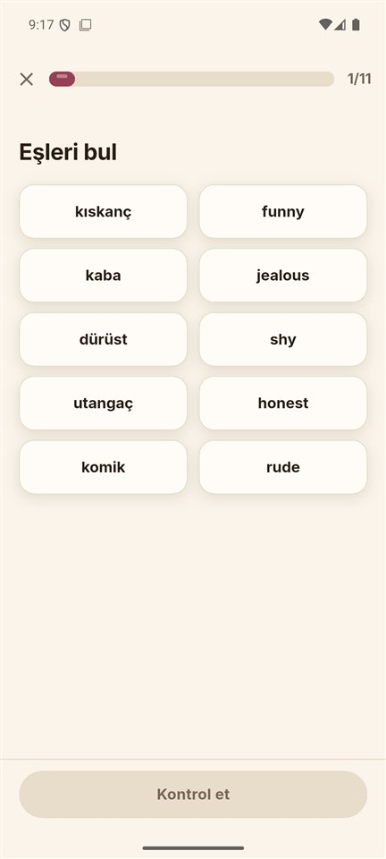

<div align="center">

# Dilbaz

**Türkler için, Türkçe düşünerek İngilizce.**
Can yok, ceza yok, reklam yok. Her yanlışın arkasındaki Türkçe alışkanlığı gösteren bir öğrenme yolu.

[](https://github.com/HalilMertDeveli/lingora/actions/workflows/ci.yml)
[](https://github.com/HalilMertDeveli/lingora/actions/workflows/release.yml)


</div>

---

## Dilbaz nedir?

Dilbaz, Türkçe konuşanlar için yazılmış bir İngilizce öğrenme uygulamasıdır (Flutter, Android/iOS/web).
Adı "dili güzel, lafı akıcı" anlamına gelir. Uygulama bir derse sıradan bir dil uygulaması gibi
yaklaşmaz. Her soruda Türklerin sık yaptığı hataları hedefler: "I am agree", "He don't", "solve the bug"…
Yanlış cevapta hatanın hangi Türkçe alışkanlıktan geldiğini Türkçe olarak açıklar.

Kimlik olarak Türk kültürünü taşır. Sunucu **Çaycı Dayı**, Çocuk modunun karakteri **Pofuduk**'tur.
Selamlaşma ünitelerinde düğümler çay bardağıdır. Diğer ünitelerde ise konunun kendi nesneleri
kullanılır: seyahatte bavul ve uçak, yemekte simit ve tabak, teknolojide terminal.

## Rakamlarla

| Parça | İçerik |
|---|---|
| **Genel İngilizce (A1 → B2)** | 8 bölüm · 94 ünite · 364 ders · 3.504 alıştırma |
| **YDS / YÖKDİL** | 54 ünite · 216 ders · 3.252 soru · 8 tam deneme (80 soru / 180 dk) · 12 haftalık plan |
| **LGS İngilizce (8. sınıf)** | MEB'in 10 ünitesi · 40 ders · 510 soru · gerçek formatta 2 bölüm denemesi |
| **Yazılımcı İngilizcesi** | 604 kelime · bilgi haritası · aralıklı tekrar · 8 iş senaryosu |
| **Meslek paketleri** | Turizm (5 ünite) · İş görüşmesi (4 ünite) |
| **Notlarım** | Notion notlarından 80 adımlık Gramer Yolu, 856 kelimelik sözlük, 193 gramer notu |
| **Türk hata dedektörü** | 106 kural: yazdığın cümledeki Türkçe kaynaklı hatayı yakalar |

Bütün içerik bu proje için özgün olarak yazılmıştır. Resmî sınav soruları ya da başka uygulamaların
içerikleri kullanılmamıştır.

## Ekranlar

### Öğrenme yolu: her ünite kendi konusunu anlatır

<p>


</p>

Yol sekiz bölümden oluşur (Mahalle, Çarşı, Vapur, Ofis, Yolculuk, Kütüphane, Toplantı, Sahne).
Her bölüm bir CEFR seviyesine karşılık gelir. Bölüm başında "Bölüme atla" sınavı vardır ve cezası yoktur.
Seviye testine göre uygun bölümden başlarsın. Kilitli bölümler katlanmış gelir, bu yüzden uygulama hızlı açılır.

### Ders akışı

<p>



</p>

Alıştırma türleri: seçmeli, çeviri, boşluk doldurma, dinleme, eşleştirme, konuşma ve sınav tipi
çoktan seçmeli (`choice`, uzun okuma parçalı). Doğru cevapta "Tavşan kanı gibi!" gibi değişen Türkçe
övgüler çıkar. Yanlış cevapta hiçbir şey kaybedilmez: soru tekrar gelir ve "Hatalarını çalış" listesine
düşer. Dersten çıkmak da cezasızdır.


### Sınav yolları: rastgele soru değil, sıralı çalışma

<p>


</p>

Her ünite aynı sırayla ilerler:
1. **Rehber:** Türkçe konu anlatımı, özet tablo ve sınav ipuçları.
2. **Dersler:** kelime, kalıp, diyalog ve okuma.
3. **Ünite testi.**
4. **Bölüm denemesi.**

Eski soru bankası ve tam paket denemeler Pratik sekmesinde durur. Planlar ayrı belgelerde:
[LGS planı](docs/sinav/lgs-plan.md) · [YDS/YÖKDİL planı ve 12 haftalık takvim](docs/sinav/yds-plan.md)

> ALES'te İngilizce bölümü yoktur. Yetişkin akademik sınavlar için YDS, e-YDS ve YÖKDİL hedeflenir.

### Pratik, lig, görevler, profil

<p>


</p>

- **Pratik:** yapay zekâ ile rol yapma sohbeti, telaffuz koçu (th, w/v, ship/sheep), hatalarını çalış,
  60 saniyelik hızlı eşleştirme, okuma hikâyeleri ve hata analizi.
- **Lig ve görevler:** haftalık XP ligi, günlük görevler, seri ve günlük hedef.
- **Profil:** istatistikler, sık yaptığın hatalar ve Türkçe ipuçları, hesap ve yedekleme.

### Yazılımcı İngilizcesi, Çocuk modu, koyu tema

<p>


</p>

## Ücretsiz ve Premium

Temel öğrenme her zaman ücretsizdir, reklam yoktur. **Dilbaz Premium** yapay zekâ sohbeti, sınırsız
deneme, detaylı hata analizi ve bulut yedekleme verir. Ek seçenekler aile planı, sınav paketleri ve
**Dilbaz Kurumsal**tır (okul ve şirketler için koltuk, sınıf ve ödev). Ayrıntılar:
[gelir planı](docs/gelir-plani.md) · [abonelik](docs/abonelik.md) · [kurumsal](docs/kurumsal.md)

## Yapılacaklar

Sıradaki işler iki tarafa ayrıldı: geliştirme ekibinin tarafı ve uygulama sahibinin tarafı.
👉 **[docs/yapilacaklar.md](docs/yapilacaklar.md)**

---

## Geliştiriciler için

<details>
<summary><b>Çalıştırma ve test</b></summary>

```bash
flutter pub get
flutter run
flutter test
```

Kod biçimi: `dart format -l 110 lib test`. CI her PR'da format, analyze ve testleri, ayrıca Functions
emülatör testlerini çalıştırır.

</details>

<details>
<summary><b>Firebase</b></summary>

Uygulama varsayılan olarak `dilbaz-3392e` projesine bağlanır. Giriş yöntemleri: anonim, e-posta/şifre,
Google ve telefon. Veriler Firestore'da tutulur. Mod `--dart-define=LINGORA_FIREBASE=off|emulator|prod`
ile değiştirilir. Lig, yapay zekâ sohbeti ve abonelik doğrulaması `functions/` altındaki Cloud Functions
ile çalışır.
Ayrıntılar: [istemci](docs/firebase.md) · [sunucu](docs/firebase-backend.md)

</details>

<details>
<summary><b>Proje yapısı</b></summary>

- `lib/models`, `lib/data`: içerik modelleri, ilerleme, bölümler, lig, görevler, aralıklı tekrar
- `lib/screens`, `lib/nav`: ekranlar ve sekme başına gezinme
- `lib/exercises`: alıştırma türleri
- `lib/ui`: tema, animasyonlar, maskotlar
- `assets/courses`: genel kurs (`tr_en` + bölüm dosyaları), sınav yolları (`exam_lgs`, `exam_yds`), meslek paketleri
- `assets/themes`: ünite temalarının özgün SVG'leri ([tasarım rehberi](docs/tasarim/temalar.md))
- `assets/exams`, `assets/exam_packs`, `assets/notes`, `assets/vocab`: soru bankaları, notlar, kelimeler
- `functions/`: Cloud Functions (TypeScript) · `lib/admin/`: web yönetim paneli
- `test/`: mantık, arayüz ve içerik doğrulama testleri

</details>

<details>
<summary><b>Teknik kimlikler neden "lingora"?</b></summary>

Uygulamanın adı Dilbaz'dır. Ancak bazı teknik kimlikler eski adı taşır, çünkü bunları değiştirmek
Firebase'i ve abonelikleri bozar:
- Dart paket adı `lingora`
- `com.lingora.lingora` (Android `applicationId`, iOS bundle id)
- Play ürün kimlikleri (`lingora_premium_*`)
- Firestore alan adları
- GitHub repo adı

</details>

<details>
<summary><b>Sürüm ve imzalama</b></summary>

Her `main` push'unda **Release APK** iş akışı bir APK derler ve `lingora-apk` artifact'ı olarak yükler.
`v*` etiketi gönderildiğinde GitHub Release oluşturulur. Gerçek imza için keystore dosyasını base64
olarak şu repository secret'larına ekle: `ANDROID_KEYSTORE_BASE64`, `ANDROID_KEYSTORE_PASSWORD`,
`ANDROID_KEY_ALIAS`, `ANDROID_KEY_PASSWORD`. Bu secret'lar yoksa APK debug anahtarıyla imzalanır.

</details>

<details>
<summary><b>Notion notlarını güncelleme</b></summary>

```bash
node tool/import_notes.js <dönüştürülmüş-notlar-klasörü>
```

</details>

Görseller: Çaycı Dayı ve Pofuduk uygulama sahibine aittir. Ünite temaları bu proje için çizilmiştir.
Kaynaklar [docs/assets.md](docs/assets.md) dosyasındadır.
