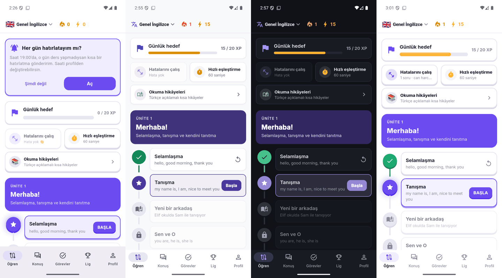
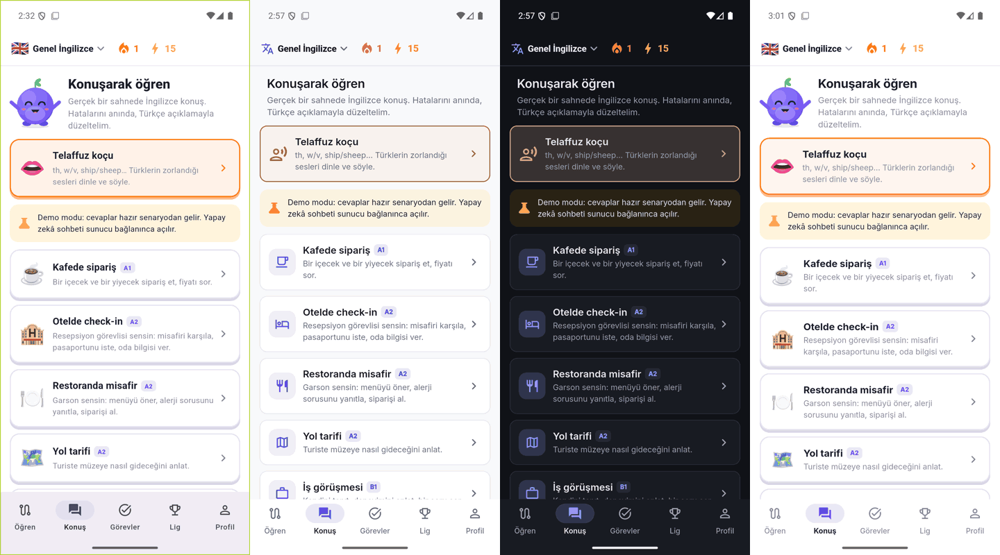
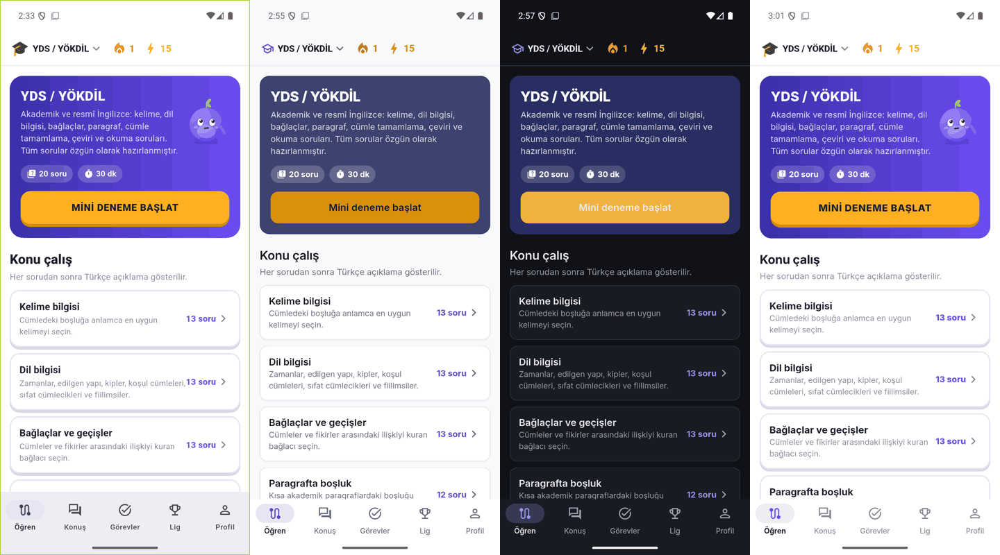
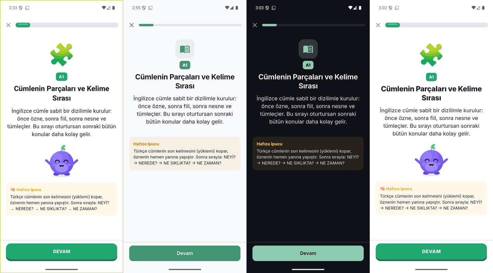
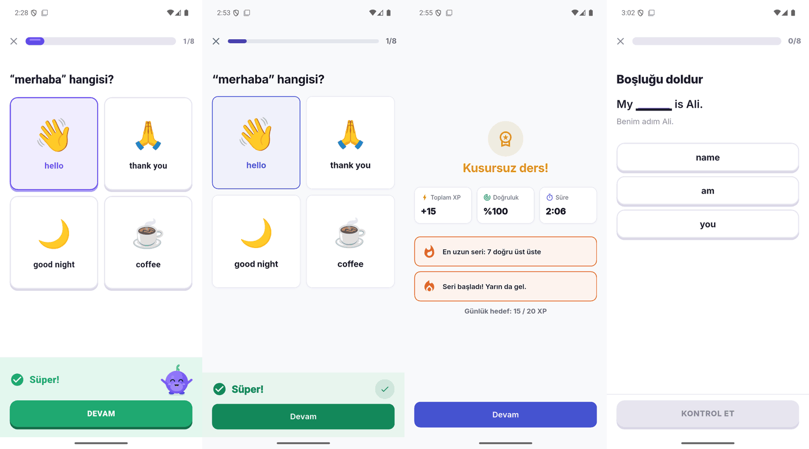

# Dilbaz tasarım sistemi

Dilbaz'ın **varsayılan görünümü yetişkin** (sade, sakin, üniversite öğrencisi ve çalışanlar için).
**Çocuk modu** isteğe bağlıdır ve eski oyunsu görünümü (büyük ve hareketli Çaycı Dayı maskotu, emoji, konfeti, zıplayan
animasyonlar) geri getirir. Her iki mod da **açık** ve **koyu** temada çalışır.

Kural: Stil ekranlardan değil **tema ve ortak widget'lardan** gelir. Yeni ekran yazarken aşağıdaki
token ve widget'ları kullanın; renk/emoji/gölge kodlamayın.

## Ayarlar

| | |
|---|---|
| Sağlayıcı | `appSettingsProvider` (`lib/data/app_settings.dart`) |
| Saklama | `SharedPreferences` → `settings_v1` (`{"mode":"adult|kid","theme":"system|light|dark"}`); `progress_v1`'den ayrı, ilerleme sıfırlansa da kalır |
| Değerler | `AppMode.adult` (Yetişkin, varsayılan) / `AppMode.kid` (Çocuk) · `ThemePref.system` (varsayılan) / `light` / `dark` |
| Arayüz | Onboarding'de "Kimin için?" adımı · Profil > **Görünüm** (`lib/ui/appearance.dart`) |

`LingoraApp` (main.dart) ayarı izler, `buildTheme(mode:, brightness:)` ile temayı kurar ve
`PaletteScope` ile global paleti günceller. Mod değişince ekranlar durumunu kaybetmeden yeniden çizilir.

## Token'lar (`lib/theme.dart`)

### Renkler — `context.palette` (tercih edilen) veya `Brand.*`

| Token | Yetişkin açık | Yetişkin koyu | Kullanım |
|---|---|---|---|
| `primary` | `#4553D0` | `#8E98F5` | Ana buton, seçim, bağlantı |
| `onPrimary` | beyaz | `#0E1120` | Primary üstündeki yazı/ikon |
| `ink` | `#14171F` | `#E8EAF0` | Ana metin |
| `muted` | `#636B7A` | `#9AA2B1` | İkincil metin, ikonlar |
| `line` | `#E3E6EC` | `#2B303B` | Kenarlık, ayırıcı |
| `surface` | `#F2F4F7` | `#1F232C` | Input, çip, ilerleme izi |
| `card` | beyaz | `#181B22` | Kart / sheet arka planı |
| `background` | `#F8F9FB` | `#101217` | Sayfa arka planı |
| `success` / `successBg` | `#13885A` / `#E8F5EE` | `#45C08A` / `#15281F` | Doğru cevap |
| `error` / `errorBg` | `#D03A33` / `#FCEDEC` | `#F2766C` / `#2E1816` | Yanlış cevap |
| `accent` / `accentBg` | `#D9900B` / `#FCF3E1` | `#F0B13E` / `#2A2214` | İpucu, "Daha doğal" kutuları |
| `mascot` / `onMascot` / `mascotBg` | `#B85A00` / beyaz / `#FFF3E6` | `#F39A3D` / `#1A0E00` / `#2E2010` | Maskot turuncusu: giriş ekranı, marka vurgusu (her iki modda aynı). Kontrast testi: `test/mascot_test.dart` |
| `streak`, `xp`, `info` | turuncu, amber, mavi | | İstatistikler |

Çocuk modu paletleri (`Palette.kidLight` / `kidDark`) eski mor `#6C4CF1` temayı korur.

`Brand.*` artık **sabit değil**, aktif paleti okuyan getter'dır; bu yüzden `const TextStyle(color: Brand.ink)`
yazılamaz (`const`'u kaldırın). Eski kod çalışmaya devam eder, ama koyu temada doğru görünmesi için
**asla `Colors.white` arka plan veya `Color(0xFF...)` metin rengi kodlamayın**:

- Kart/arka plan → `Brand.card` / `Brand.background`
- Renkli zemin üstündeki yazı → `onColor(zemin)` (beyaz ya da koyu, okunabilir olanı seçer)
- Ünite/seviye/özellik renkleri gibi parlak içerik renkleri → `Brand.tone(renk)` (yetişkinde yumuşatır, çocukta aynen)
- Renkli başlık bandı (ünite, sınav, notlar) → `decoration: context.lingora.hero(renk, from: ikinciRenk)`
  (çocukta parlak gradyan, yetişkinde koyu düz ton; üstüne beyaz yazı)

### Tipografi

Yazı tipi **Inter** (SIL OFL, `assets/fonts/`). Yetişkin mod `LingoraSans` ailesini kullanır: bu ailede
`w800/w900` Bold dosyasına, `w700` SemiBold'a eşlenir; yani satır içi `FontWeight.w900` yetişkinde sakin
bir başlık olur. Ölçek `Theme.of(context).textTheme`: `headlineSmall 24`, `titleLarge 20`,
`titleMedium 16`, `bodyLarge 16`, `bodyMedium 14`, `bodySmall 12 (muted)`, `labelSmall 11`.

### Boşluk, köşe, hareket

- `Space.xs/sm/md/lg/xl/xxl` = 4 / 8 / 12 / 16 / 24 / 32
- `Radii.sm/md/lg/xl` = 8 / 12 / 16 / 20 (yetişkin kart ve buton 12, çocuk 16)
- `AppDurations.fast/normal` = 150 / 220 ms. Yetişkinde animasyonlar kısa fade/slide; zıplama, konfeti,
  nabız (Pulse) yok.

## Ortak widget'lar (mod bilgisi içlerinde)

| Widget | Yetişkin | Çocuk modu |
|---|---|---|
| `TapCard` | Düz kart, 1 px kenarlık, hafif gölge, 12 köşe | 3D alt kenar, basınca çöker |
| `PressableButton` | Düz buton, **cümle düzeni** ("KONTROL ET" → "Kontrol et") | Kalın 3D buton, BÜYÜK HARF |
| `Mascot` | Küçük (44–72 px), hareketsiz Çaycı Dayı; `decorative: true` ise hiç görünmez | Büyük, hareketli Çaycı Dayı |
| `EmptyState(message:)` | Boş liste: küçük maskot + mesaj | Büyük maskot + mesaj |
| `Confetti` | Kapalı | Konfeti |
| `PopIn` | 260 ms fade + 8 px kayma, yarı gecikme | Elastik büyüme |
| `Pulse` | Kapalı | Nabız |
| `Shake` | Yarım mesafe | Tam |
| `GlossyProgress` | İnce (≤8 px) düz bar | Kalın parlak bar |
| `Glyph(emoji:, icon:)` | Material ikon | Emoji |
| `IconBadge(icon:, emoji:)` | Renkli zeminde ikon | Emoji (verilmişse) |
| `SectionLabel('KURSLAR')` | İnce küçük başlık | Kalın küçük başlık |
| `kidEmoji('💡')` | `''` | `'💡 '` (metin öneki) |

Mod bilgisi: `context.isKid`, `context.lingora` (`LingoraTheme`: `mode`, `palette`, `tone()`, `hero()`),
ya da context yoksa `Brand.isKid`.

## Yeni ekran kontrol listesi

1. Arka planı `Scaffold`'a bırakın; kartlar için `TapCard` kullanın.
2. Metin rengi vermeyin (tema verir) ya da `Brand.ink/muted` kullanın; `Colors.white/black` sadece renkli zemin üstünde ve tercihen `onColor()` ile.
3. Dekoratif emoji yerine `Glyph`/`IconBadge`; metin içi emoji için `kidEmoji()`. İçerik emojileri (ör. resimli seçenek kartları) kalabilir.
4. Başlık maskotları `Mascot(..., decorative: true)`; sonuç/geri bildirim maskotları normal `Mascot` (yetişkinde küçük ve hareketsiz olur).
5. Buton etiketleri büyük harf yazılabilir; yetişkinde otomatik cümle düzenine çevrilir. **Testlerde** yetişkin görünümü varsayılan olduğundan `find.text('Kontrol et')` kullanın.
6. Hem açık hem koyu temada bakın (Profil > Görünüm > Tema).

## Ekran görüntüleri

Önce → yetişkin açık → yetişkin koyu → Çocuk modu:

Ders: önce (geri bildirim) → yetişkin geri bildirim → yetişkin sonuç → Çocuk modu ders:

Tekil görüntüler `docs/tasarim/` altında: `once-*`, `yetiskin-acik-*`, `yetiskin-koyu-*`, `cocuk-*`.
