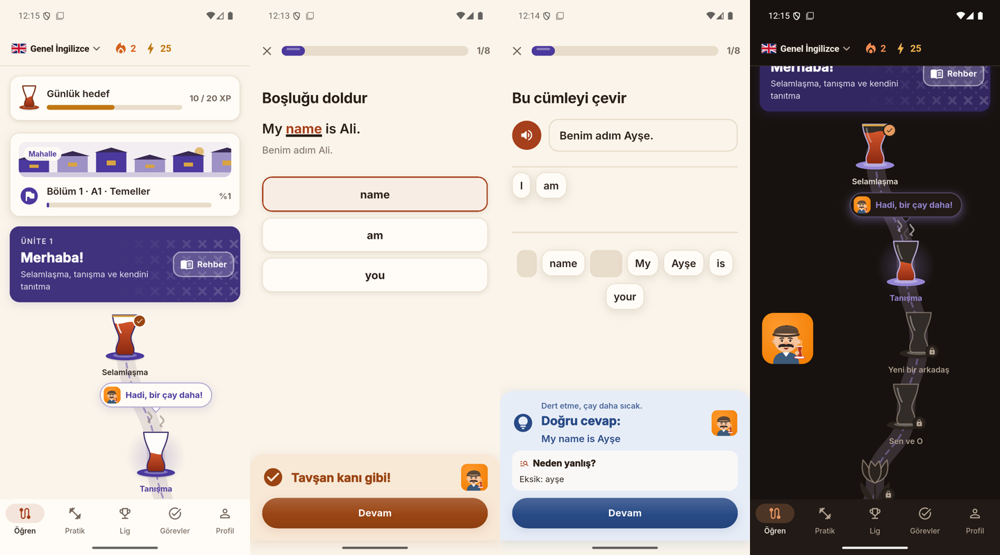
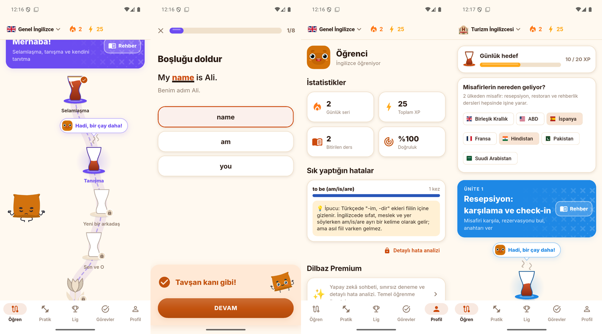

# Dilbaz tasarım sistemi

Dilbaz'ın **varsayılan görünümü yetişkin** (sade, sakin, üniversite öğrencisi ve çalışanlar için).
**Çocuk modu** isteğe bağlıdır ve eski oyunsu görünümü (büyük ve hareketli Pofuduk maskotu, emoji, çay kutlaması, zıplayan
animasyonlar) geri getirir. Her iki mod da **açık** ve **koyu** temada çalışır.

Kural: Stil ekranlardan değil **tema ve ortak widget'lardan** gelir. Yeni ekran yazarken aşağıdaki
token ve widget'ları kullanın; renk/emoji/gölge kodlamayın.

## Ayarlar

| | |
|---|---|
| Sağlayıcı | `appSettingsProvider` (`lib/data/app_settings.dart`) |
| Saklama | `SharedPreferences` → `settings_v1` (`{"mode":"adult|kid","theme":"system|light|dark"}`); `progress_v1`'den ayrı, ilerleme sıfırlansa da kalır |
| Değerler | `AppMode.adult` (Yetişkin, varsayılan) / `AppMode.kid` (Çocuk) · `ThemePref.system` (varsayılan) / `light` / `dark` |
| Arayüz | Onboarding'de "Kimin için?" adımı · Profil > **Görünüm** (`lib/ui/appearance.dart`) |

`LingoraApp` (main.dart) ayarı izler, `buildTheme(mode:, brightness:)` ile temayı kurar ve
`PaletteScope` ile global paleti günceller. Mod değişince ekranlar durumunu kaybetmeden yeniden çizilir.

## Token'lar (`lib/theme.dart`)

### Renkler — `context.palette` (tercih edilen) veya `Brand.*`

| Token | Yetişkin açık | Yetişkin koyu | Kullanım |
|---|---|---|---|
| `primary` | `#E06C00` | `#F39A3D` | Ana buton, seçim, bağlantı (Lexigo turuncusu; çocuk modu `#F17F04` / `#FF9F43`) |
| `onPrimary` | beyaz | `#1A0E00` | Primary üstündeki yazı/ikon |
| `ink` | `#14171F` | `#E8EAF0` | Ana metin |
| `muted` | `#636B7A` | `#9AA2B1` | İkincil metin, ikonlar |
| `line` | `#E3E6EC` | `#2B303B` | Kenarlık, ayırıcı |
| `surface` | `#F2F4F7` | `#1F232C` | Input, çip, ilerleme izi |
| `card` | beyaz | `#181B22` | Kart / sheet arka planı |
| `background` | `#F8F9FB` | `#101217` | Sayfa arka planı |
| `success` / `successBg` | `#13885A` / `#E8F5EE` | `#45C08A` / `#15281F` | Doğru cevap |
| `error` / `errorBg` | `#D03A33` / `#FCEDEC` | `#F2766C` / `#2E1816` | Yanlış cevap |
| `accent` / `accentBg` | `#D9900B` / `#FCF3E1` | `#F0B13E` / `#2A2214` | İpucu, "Daha doğal" kutuları |
| `mascot` / `onMascot` / `mascotBg` | `#B85A00` / beyaz / `#FFF3E6` | `#F39A3D` / `#1A0E00` / `#2E2010` | Maskot turuncusu: giriş ekranı, marka vurgusu (her iki modda aynı). Kontrast testi: `test/mascot_test.dart` |
| `streak`, `xp`, `info` | turuncu, amber, mavi | | İstatistikler |

Çocuk modu paletleri (`Palette.kidLight` / `kidDark`) daha canlı tonlar kullanır; vurgu iki modda da turuncudur.

`Brand.*` artık **sabit değil**, aktif paleti okuyan getter'dır; bu yüzden `const TextStyle(color: Brand.ink)`
yazılamaz (`const`'u kaldırın). Eski kod çalışmaya devam eder, ama koyu temada doğru görünmesi için
**asla `Colors.white` arka plan veya `Color(0xFF...)` metin rengi kodlamayın**:

- Kart/arka plan → `Brand.card` / `Brand.background`
- Renkli zemin üstündeki yazı → `onColor(zemin)` (beyaz ya da koyu, okunabilir olanı seçer)
- Ünite/seviye/özellik renkleri gibi parlak içerik renkleri → `Brand.tone(renk)` (yetişkinde yumuşatır, çocukta aynen)
- Renkli başlık bandı (ünite, sınav, notlar) → `decoration: context.lingora.hero(renk, from: ikinciRenk)`
  (çocukta parlak gradyan, yetişkinde koyu düz ton; üstüne beyaz yazı)

### Tipografi

Yazı tipi **Inter** (SIL OFL, `assets/fonts/`). Yetişkin mod `LingoraSans` ailesini kullanır: bu ailede
`w800/w900` Bold dosyasına, `w700` SemiBold'a eşlenir; yani satır içi `FontWeight.w900` yetişkinde sakin
bir başlık olur. Ölçek `Theme.of(context).textTheme`: `headlineSmall 24`, `titleLarge 20`,
`titleMedium 16`, `bodyLarge 16`, `bodyMedium 14`, `bodySmall 12 (muted)`, `labelSmall 11`.

### Boşluk, köşe, hareket

- `Space.xs/sm/md/lg/xl/xxl` = 4 / 8 / 12 / 16 / 24 / 32
- `Radii.sm/md/lg/xl` = 8 / 12 / 16 / 20 (yetişkin kart ve buton 12, çocuk 16)
- `AppDurations.fast/normal` = 150 / 220 ms. Yetişkinde animasyonlar kısa fade/slide; zıplama, buhar ve kutlama,
  nabız (Pulse) yok.

## Ortak widget'lar (mod bilgisi içlerinde)

| Widget | Yetişkin | Çocuk modu |
|---|---|---|
| `TapCard` | Dokunulabilirse 3D: 2 px kenar + 3 px dudak, basınca iner; değilse düz kart | 2 px kenar + 4 px dudak, basınca çöker |
| `PressableButton` | Yuvarlak (hap) 3D buton, 4 px dudak, **cümle düzeni** ("KONTROL ET" → "Kontrol et") | Kalın 3D hap buton, 5 px dudak, BÜYÜK HARF |
| `Mascot` | Küçük (44–72 px), hareketsiz Çaycı Dayı; `decorative: true` ise hiç görünmez | Büyük, hareketli Çaycı Dayı |
| `EmptyState(message:)` | Boş liste: küçük maskot + mesaj | Büyük maskot + mesaj |
| `Confetti` | Kendi `ConfettiPainter` çizicimiz; kutlama ekranlarında (animasyon azaltılmışsa yok) | Aynı |
| `PopIn` | 260 ms fade + 8 px kayma, yarı gecikme | Elastik büyüme |
| `Pulse` | Kapalı | Nabız |
| `Shake` | Yarım mesafe | Tam |
| `GlossyProgress` | İnce (≤8 px) düz bar | Kalın parlak bar |
| `Glyph(emoji:, icon:)` | Material ikon | Emoji |
| `IconBadge(icon:, emoji:)` | Renkli zeminde ikon | Emoji (verilmişse) |
| `SectionLabel('KURSLAR')` | İnce küçük başlık | Kalın küçük başlık |
| `kidEmoji('💡')` | `''` | `'💡 '` (metin öneki) |

Mod bilgisi: `context.isKid`, `context.lingora` (`LingoraTheme`: `mode`, `palette`, `tone()`, `hero()`),
ya da context yoksa `Brand.isKid`.

## Yeni ekran kontrol listesi

1. Arka planı `Scaffold`'a bırakın; kartlar için `TapCard` kullanın.
2. Metin rengi vermeyin (tema verir) ya da `Brand.ink/muted` kullanın; `Colors.white/black` sadece renkli zemin üstünde ve tercihen `onColor()` ile.
3. Dekoratif emoji yerine `Glyph`/`IconBadge`; metin içi emoji için `kidEmoji()`. İçerik emojileri (ör. resimli seçenek kartları) kalabilir.
4. Başlık maskotları `Mascot(..., decorative: true)`; sonuç/geri bildirim maskotları normal `Mascot` (yetişkinde küçük ve hareketsiz olur).
5. Buton etiketleri büyük harf yazılabilir; yetişkinde otomatik cümle düzenine çevrilir. **Testlerde** yetişkin görünümü varsayılan olduğundan `find.text('Kontrol et')` kullanın.
6. Hem açık hem koyu temada bakın (Profil > Görünüm > Tema).

## Ekran görüntüleri

Önce → yetişkin açık → yetişkin koyu → Çocuk modu:

Ders: önce (geri bildirim) → yetişkin geri bildirim → yetişkin sonuç → Çocuk modu ders:

Tekil görüntüler `docs/tasarim/` altında: `once-*`, `yetiskin-acik-*`, `yetiskin-koyu-*`, `cocuk-*`.

## Arayüz animasyonları (feature/arayuz-animasyon)

Referans uygulamanın davranış tarifi ve Dilbaz karşılıkları: [arayuz-referans.md](arayuz-referans.md).

- Oturum parçaları `lib/ui/session.dart`: `SessionHeader`, `SessionProgressBar` (seri vurgusu), `CheckBar`, `AnswerFeedbackPanel`. Yeni bir cevap-kontrol ekranı bunları kullanmalı.
- Yol haritası parçaları `lib/screens/path_map.dart`: `TeaNode`, `TeaInvite`, `LessonCard`, `UnitBand`, `showUnitGuide` (aşağıda "Çay kimliği").
- Kutlama zinciri: `celebrationSteps(reward)` (görevler, sonra seri), `showEndSequence` ile.
- Geçişler `lib/ui/transitions.dart`: `fullscreenDialog` rotaları aşağıdan yukarı açılır; sekmeler `FadeThroughIn`.
- Ses ve titreşim `SessionFx` (`AppSettings.sound`). "Animasyonları azalt" (`AppSettings.reduceMotion`) uygulama kökünde `MediaQuery.disableAnimations` değerini açar. Yeni animasyon yazarken `MediaQuery.disableAnimationsOf(context)` ya da `loopsEnabled` kontrol edin.

## Konu temaları (feature/konu-temalari)

Her ünite kendi konusunun nesneleriyle çizilir; çay yalnızca selamlaşma, misafirlik, mahalle ve sohbet ünitelerinde. Ayrıntı, stil rehberi ve Figma bağlantısı: [docs/tasarim/temalar.md](tasarim/temalar.md).

## Çay kimliği (feature/ozgun-tasarim)

PR #26 arayüzü referans uygulamaya fazla benzetmişti. Bu bölüm Dilbaz'ın kendi kimliğini anlatır: bir çay bahçesinde yürüyüş.

**Renkler** (`lib/theme.dart`): çay kırmızısı / kehribar (`primary`, `success`), İznik lacivertı (`error`, `info`), krem kâğıt (`background`, `card`) ve Lexigo turuncusu (`mascot`). Açık ve koyu tema; Çocuk modu daha canlı. Yanlış cevap rengi kırmızı değil, yumuşak lacivert.

**Çizimler** (`lib/ui/tea_art.dart`, hepsi vektör, asset yok):
- `TeaGlassPainter`: ince belli çay bardağı ve tabağı. Bitmiş ders dolu, demli ve altın yaldızlı; sıradaki ders yarım, buharlı (`Steam`) ve hafif nefes alır; kilitli ders boş cam.
- `TeapotPainter`: ödül düğümü, iki katlı çaydanlık. Açılınca kapağı kalkar, yanına şeker küpleri düşer (ödül XP, "şeker" olarak gösterilir).
- `TulipPainter`: ünite sınavı, lale rozeti. Geçilince kırmızı açar.
- `LanePainter`: düğümleri bağlayan kesik çizgili, yumuşak S kıvrımlı patika (`laneOffset`).
- `DistrictPainter`: bölüm kartlarındaki mekân şeridi. Bölüm 1 Mahalle, 2 Çarşı, 3 Vapur, 4 Ofis, 5 Yolculuk, 6 Kütüphane, 7 Toplantı, 8 Sahne (`District.of`).
- `CiniPainter`: ünite bandının sağında soluk İznik motifi.

**Davet balonu** (`TeaInvite`): "Başla" yerine sunucunun yüzüyle "Hadi, bir çay daha!" (ödülde "Demlik hazır", sınavda "Lale seni bekliyor").

**Geri bildirim** (`AnswerFeedbackPanel`): doğruda çay rengi ve dönen övgü (`teaPraises`: "Şıkır şıkır!", "Tavşan kanı gibi!"…), yanlışta lacivert ve `softRetries` ("Bir daha dene, olur o kadar."). Ceza yok.

**Basma efekti** (`JellyPress`): "jelibon". Buton ve kartlar basılıyken yumuşakça ezilir, bırakınca küçük bir yaylanmayla geri gelir; gölge yumuşak ve sıcak (`softShadow`). 3B dudak yok. Animasyonlar azaltılınca hareket etmez.

**Kutlama** (`TeaCelebration`): konfeti yerine alttan yükselen buhar, düşen şeker küpleri ve lale yaprakları.

**İki maskot** (`lib/ui/mascot.dart`):
- Yetişkin modu: Çaycı Dayı (`Dayi`) ana sunucu, küçük ve hareketsiz.
- Çocuk modu: Pofuduk (`Pofuduk`) ana karakter; her ruh hâlinin kendi pozu var (`pofudukPose`).
- İki modda da Pofuduk görünür: karşılama (`Mood.wave`, el sallayan), kutlama (`Mood.cheer`, gözlüklü), seri (`Mood.happy`, dans eden), çay molası (`Mood.calm`, meditasyon).
- Çocuk modu profil avatarı Pofuduk'un kare yüzü (`pofudukAvatar`), giriş ekranı çizimi telefonlu Pofuduk (`pofudukAccount`).

**Bayraklar**: kurs çekmecesinde sesli okuma aksanı (ABD / Birleşik Krallık, `Accent`); Turizm İngilizcesi yolunda "Misafirlerin nereden geliyor?" kartı (`GuestFlagsCard`); karşılamadaki "Yakında" dilleri (İspanyolca, Fransızca).

Testler: `test/arayuz_test.dart` (düğüm durumları, azaltılmış animasyon), `test/mascot_test.dart` (maskot ve mod), `test/ozgun_test.dart` (renkler, mekânlar, aksan, misafir bayrakları).

Yetişkin (açık yol, doğru, yanlış, koyu yol) ve Çocuk modu (yol, doğru, profil avatarı, turizm misafir bayrakları):

